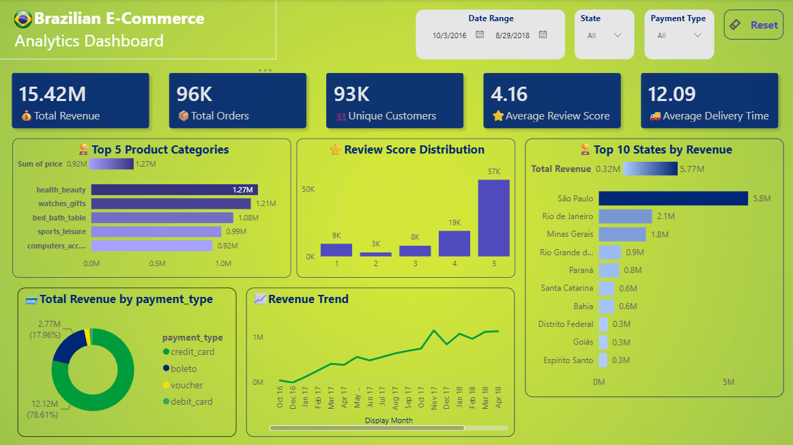
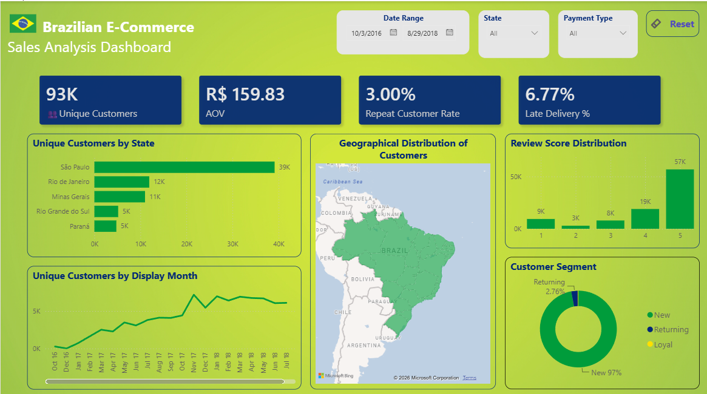

# Brazilian E-Commerce Data Analysis

An end-to-end data analytics project exploring Brazilian e-commerce transactions, sales performance, customer behaviour, payment patterns and delivery performance using Python, SQL Server and Power BI.

## Project Overview

This project analyses the Brazilian E-Commerce Public Dataset by Olist to understand business performance and identify actionable insights across sales, customers, payments and logistics.

The project follows an end-to-end workflow, from data preparation and exploratory analysis to SQL-based analysis and interactive Power BI reporting.

## Tools & Technologies

- **Python:** Pandas, NumPy, Matplotlib, Seaborn
- **SQL:** SQL Server, SSMS
- **Business Intelligence:** Power BI, DAX
- **Data Preparation:** Data cleaning, merging, transformation and validation

## Project Workflow

### 1. Python – Data Cleaning & Exploratory Data Analysis

- Loaded and explored the source datasets.
- Cleaned missing values and handled data inconsistencies.
- Merged relevant datasets to create an analytical dataset.
- Created order-level and review-level datasets.
- Analysed sales, product categories, customers and delivery performance.
- Exported prepared datasets for further SQL analysis.

**Notebook:** [`Brazilian_eCommerce.ipynb`](notebooks/Brazilian_eCommerce.ipynb)

### 2. SQL Server – Business Analysis

Performed additional analysis using SQL, including:

- Total revenue and monthly revenue trends.
- Revenue contribution by product category.
- Top customers by spending.
- One-time versus repeat customers.
- Payment method distribution.
- State-wise delivery performance.
- Late delivery rates.
- Relationship between delivery performance and review scores.

**SQL script:** [`Brazilian_eCommerce.sql`](sql/Brazilian_eCommerce.sql)

### 3. Power BI – Interactive Dashboard

Developed a two-page dashboard to explore business performance.

**Page 1 – Sales & Revenue Overview**

- Revenue and order KPIs.
- Product category performance.
- Review score distribution.
- State-wise revenue.
- Payment method distribution.
- Monthly revenue trends.

**Page 2 – Customer & Delivery Insights**

- Customer distribution by state.
- Geographical customer distribution.
- Customer segmentation.
- Review score distribution.
- Average order value.
- Repeat customer rate.
- Late delivery percentage.

**Download:** [Power BI Dashboard – v1.0.0](https://github.com/AravindK37/brazilian-ecommerce-analysis/releases/tag/v1.0.0)
